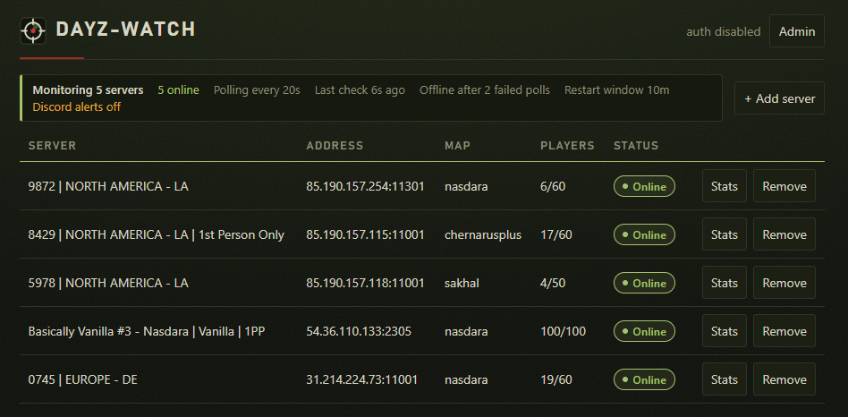
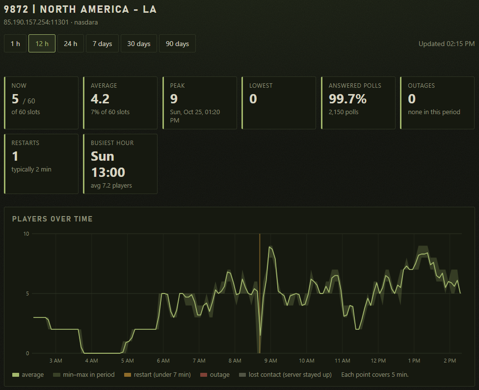

# dayz-watch

[](https://github.com/nwish/dayz-watch/actions/workflows/ci.yml)
[](https://github.com/nwish/dayz-watch/releases)
[](https://github.com/nwish/dayz-watch/actions/workflows/publish.yml)
[](https://github.com/nwish/dayz-watch/stargazers)
[](https://github.com/nwish/dayz-watch/commits/main)
[](LICENSE)




A dependency-free web app that watches and polls basic stats on DayZ servers via the Steam A2S_INFO query (UDP).  Comes with a web UI to manage and view monitored servers.  

Click/tap on a server from the main list to open a live stats view with player count change alerts.  Supports per-server Discord webhooks (or a default from an environment variable) to post player count change alerts.

The server list sorts by any column: click a header (first click ascending, Players descending; second click reverses; third restores the default order). On phones, where the header row is hidden, use the **Sort** control above the list. Servers with no value for the column (no answer yet, or offline for Players) always sort last, and the choice is remembered in the browser.

## Run with Docker Compose

Currently on `1.0.0-rc1` only - there is no `latest` tag yet.

**compose.yaml**
```sh
services:
  dayz-watch:
    image: ghcr.io/nwish/dayz-watch:1.0.0-rc1
    restart: unless-stopped
    ports:
      - "${HOST_PORT:-8080}:8080"
    env_file:
      - path: .env
        required: false
    environment:
      PORT: "8080"
    volumes:
      - dayz-watch-data:/data

volumes:
  dayz-watch-data:
```

Then `docker compose up -d`

Open `http://<host>:8080` and sign in. Servers and users are managed in the UI.

**.env**
See [.env.example](.env.example) - copy to `.env` and edit to your liking.

| Variable | Default | Meaning |
|---|---|---|
| `ADMIN_USERNAME` | `admin` | First admin's username. Only used while no users exist. |
| `ADMIN_PASSWORD` | generated | First admin's password. Only used while no users exist; if empty, a random one is printed once in the container log. |
| `AUTH_DISABLED` | `false` | `true` bypasses login on a trusted network: every visitor is the built-in `local` admin and existing accounts are ignored. |
| `ALLOW_PRIVATE_ADDRESSES` | `false` | Servers on loopback, LAN, link-local or other non-public IPv4 addresses are refused, on adding and on every poll. Set `true` only to monitor a server on your own network. |
| `TRUST_PROXY` | `false` | `true` behind a reverse proxy: the client IP for rate limiting comes from the last `X-Forwarded-For` entry, and `X-Forwarded-Proto`/`-Host` are honored. Enable only if clients can reach the container *only* through that proxy, or they can spoof their IP. |
| `COOKIE_SECURE` | `false` | Mark the session cookie `Secure`. Set `true` over HTTPS (implied by `TRUST_PROXY=true` with `X-Forwarded-Proto: https`). |
| `DISCORD_WEBHOOK_URL` | unset | Default webhook for servers added without their own. With no webhook, servers are still monitored but nothing is posted. |
| `POLL_SECONDS` | 30 | Poll interval (minimum 5). |
| `OFFLINE_AFTER` | 3 | Consecutive failed polls before a server counts as offline. |
| `RECHECK_SECONDS` | 5 | While a server isn't answering it is polled this often instead (minimum 2). Set it to `POLL_SECONDS` or more to turn rechecks off. |
| `REBOOT_WINDOW_MINUTES` | 10 | A server down for less than this is a normal restart, not an outage: no Discord message, shown as "restarting?". `0` treats every offline server as an outage. |
| `DIRECTORY_URL` | DZSA Launcher list | JSON list of public servers for the add-server search. Override only to point at a compatible mirror. |
| `HOST_PORT` | 8080 | Host port published by compose (the container always listens on 8080). |

The four monitoring variables (`POLL_SECONDS`, `OFFLINE_AFTER`, `RECHECK_SECONDS`, `REBOOT_WINDOW_MINUTES`) are only the **defaults**. An admin can change them on the **Admin** page under *Monitoring settings*; a saved value overrides the environment, applies to every server at once without a restart, and is kept in `settings.json`. Only the values you changed are saved, so the rest keep following `.env`. **Reset** drops an override and the `.env` value applies again. The panel accepts `POLL_SECONDS` 5–3600, `OFFLINE_AFTER` 1–100 (whole number), `RECHECK_SECONDS` 2–3600 and `REBOOT_WINDOW_MINUTES` 0–1440.

Data lives in the `dayz-watch-data` volume: `servers.json` (per-server webhook URLs in plain text, never returned by the API), `users.json` (scrypt password hashes, mode 600), `settings.json` (the admin panel's monitoring overrides) and `stats.db` (the 90-day player history, SQLite; the `-wal`/`-shm` files are normal).

The container needs outbound UDP to the query ports and outbound HTTPS to Discord. Put TLS in front of it (reverse proxy) beyond a trusted LAN: the login form sends the password in the clear over plain HTTP.

## Accounts and login

- `AUTH_DISABLED=true` skips login: every request is the `local` admin, so every API, including user management, is open to anyone who can reach the app. Use it only on a trusted LAN or behind separate access control.
- Sessions are server-side, in an `HttpOnly`, `SameSite=Strict` cookie. They expire after 12 h idle or 7 days total, and are lost on restart.
- **Roles:** `admin` can do everything including the admin page; `user` can view and manage servers but not users.
- **Admin page (`/admin`, admins only):** add users, make/unmake admin, reset passwords, delete. Resetting a password or deleting a user signs them out. You can't delete yourself or change your own role, and the last admin can't be demoted or deleted. It also shows uptime and memory, watcher query RTT (A2S response time from the app host, not player latency), history database size and counts, per-server history coverage (*deleted server* = history left by a removed server) and data directory file sizes, refreshed every 30 s.
- **Server list panel (admin page):** shows when the add-server search's list was built by its source (the DZSA list's `created` time), when this app last downloaded it, server/host/map counts, players online, passworded servers and the most common maps. **Refresh list** downloads it again immediately; otherwise it is fetched on the first search and then at most every 10 minutes. A failed refresh keeps the old list and is shown on the panel.
- **Account page (`/account`):** any user can change their own password (needs the current one; their other sessions are signed out).
- Usernames are 3-32 characters of `a-z 0-9 . _ -`; passwords 10-128.
- **Rate limiting:** 10 failed logins per username or 20 per client IP within 15 minutes locks that username/IP for 15 minutes (HTTP 429 with `Retry-After`). Counters are in memory and reset on restart. Anyone can therefore lock out a known username for 15 minutes; other accounts and valid sessions are unaffected.
- State-changing requests must be JSON and, if they carry an `Origin` header, same-origin.

## Behavior

- **Status bar:** above the server list: servers online, checking, restarting? or offline; the polling cadence; the last check; the offline and restart rules; and how many servers have Discord alerts. Its left edge is green, amber (checking/restarting) or red (offline).
- The first reading after start or add is a silent baseline.
- A post is sent only when the count differs from the previous successful reading, e.g. `**Name** (map): players 5 → **6**/60 (+1)`.
- A failed query (timeout, DNS) is shown in the UI and isn't a change.
- Status pills: **Online**, **Checking**, **Restarting**, **Offline** or **Alert error**. Hover or tap one for the full message.

### Offline servers, restars & outages

A server is **offline** after `OFFLINE_AFTER` failed polls in a row; one dropped packet is a blip and shows as `Query failing (1/3)`. After the first failure the server is rechecked every `RECHECK_SECONDS`, so a restart under two minutes is still noticed and timed to within seconds. Rechecks stop once it has been dark longer than the restart window. What happens next depends on how long it stays dark (`REBOOT_WINDOW_MINUTES`):

- **Shorter than the window: a restart.** The list and overlay say `restarting?` instead of a stale count, and nothing is posted. When it answers again the first reading is a fresh baseline, so no `players 20 → 0` post either.
- **Still dark at the end of the window: an outage.** The display changes to `offline` and, with a webhook, one message is posted: `**Name** (host:port) is **offline**: no answer for 10m (query timeout)`. It isn't repeated.
- **Back after an outage:** one message, `**Name** (map) is **back online** after 12m: 5/60 players`, counted from the first failed poll.
- A server that has never answered since the app started (a mistyped host or port) shows offline but is **not** announced, so a typo can't ping your channel. An outage already underway when the app restarts isn't announced again.
- The overlay dims the count and mutes alerts while a server is dark.

## Adding servers to monitor

*+ Add server* opens a form with a search box. Type part of a name, a number (e.g. `2305`), a map or an IP (`ip` or `ip:port`) and pick a result to fill in host and query port. All words must match; name-prefix matches rank first, then busier servers. Typing host and port by hand still works.

Either way, a server is queried once before it is saved: it must answer and identify as DayZ, or the add is refused (usually a wrong host, or the game port instead of the query port). A server that is down at that moment can't be added.

The list comes from the DZSA Launcher's public endpoint (`https://dayzsalauncher.com/api/v2/launcher/servers/dayz`, ~10k servers, no API key). The container downloads it (~13 MB) on the first search, keeps a trimmed copy in memory and refreshes it every 10 minutes; if a refresh fails it keeps the old list, and if the first download fails manual entry still works. It's a community endpoint with no SLA.

## Statistics collection & view



Every poll of every server is recorded and 90 days are kept (pruned hourly). A row's **Stats** button opens `/servers/<id>`, showing the last 12 hours by default (change it with the buttons or `?range=1h|12h|24h|7d|30d|90d`):

- **Summary cards:** current count (or *Restarting?* / *Offline*), average, peak (and when), lowest, share of polls answered, outage and restart counts, busiest weekday and hour.
- **Players over time:** average line with the min–max band, in 5 min steps (1 h, 12 h, 24 h), 30 min (7 days), 2 h (30 days) or 6 h (90 days). Dark periods are shaded **amber for a restart and red for an outage**. Hover for exact values.
- **Daily trend** and **Busiest times** (a weekday × hour heatmap of average players): 7 days and up.
- **Outages** and **Restarts:** a downtime shorter than `REBOOT_WINDOW_MINUTES` is a restart, a longer one an outage. A short downtime that ends with players already online is neither (a restarted server comes back empty, so only the watcher lost contact): it is shaded gray as *lost contact* and left out of the lists and counts. Restarts also show how many there were, how long they typically take and the hours they usually begin, so a 04:00 / 10:00 / 16:00 / 22:00 schedule shows up.

Notes:

- Polls are folded into 5-minute buckets: about 26k small rows per server over 90 days whatever `POLL_SECONDS` is. Deleting a server deletes its history.
- Days and the heatmap use the browser's timezone with one fixed UTC offset, so around a daylight-saving change the hours shift by one.
- "Answered polls" counts only polls made while the container was running; time it was down is a gap, not downtime.
- **Downtime** runs from the first failed poll to the first answered one and is recorded only once the server is declared offline, so blips aren't listed. Restart or outage is decided when the page is read, so changing `REBOOT_WINDOW_MINUTES` re-sorts the history. A downtime still open when the app restarts ends at the last moment it was watched.
- History starts when the server is added (no backfill).
- The database uses Node's built-in `node:sqlite`, still labeled experimental in Node 22; the start command silences the warning.
- `stats.db` carries a schema version and is upgraded automatically on start. A database written by a newer release is refused rather than damaged, so upgrade the app instead of downgrading it.

## Server overlay

Click a server row for a large overlay with the live player count and basic info (address, game port, map, version, platform, in-game time, BattlEye, third person, password). While it is open, a change in player count plays a three-beat alert (rising for joins, falling for leaves), flashes the window green or red and shows `+N joined` / `−N left`. The `Sound` button mutes it; Esc, ×, or a click outside closes it. Browsers allow audio only after a user gesture, so sound is enabled by the click that opens the overlay.

While the overlay is open it also asks the browser to keep the screen on (Screen Wake Lock API: iOS/iPadOS 16.4+, Chrome on Android, desktop Chrome/Safari/Firefox 126+). The `Keep awake` button turns that off and on; it defaults to on each time the page loads. The browser only allows a wake lock on HTTPS or `localhost`, so over plain HTTP on a LAN address the button is hidden and nothing is requested. The lock is released when the overlay closes, and requested again when you switch back to the tab after leaving it.

The overlay is themed by the server's map (colors, sky gradient, inline SVG landscape):

| Map (A2S name) | Theme |
|---|---|
| `nasdara`, `takistan`, `takistanplus` | Desert |
| `enoch` (Livonia) | Forest |
| `chernarusplus` (and any `chernarus*`) | Temperate |
| `namalsk` | Arctic |
| `sakhal` | Frozen island (aurora) |
| `deerisle` | Coastal |
| `esseker` | Harvest |
| anything else | Default |

Every theme has a **day** and a **night** variant, chosen from the server's in-game clock (the `HH:MM` DayZ puts in the A2S keywords): day is 06:00–17:59, night 18:00–05:59. The card switches live when the clock crosses either time. A server with no in-game time gets day.

## License

[GPL-3.0](LICENSE).