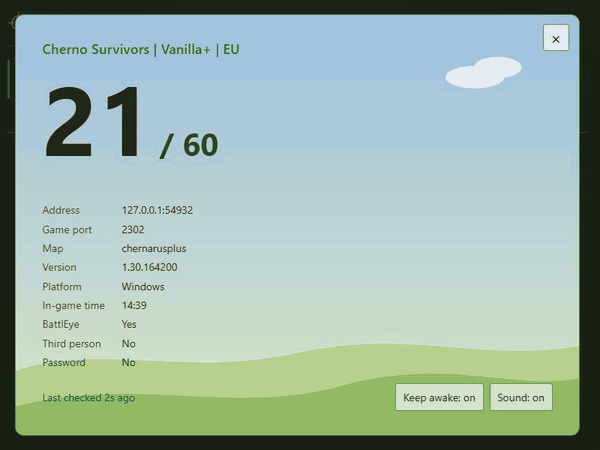

# dayz-watch

[](https://github.com/nwish/dayz-watch/actions/workflows/ci.yml)
[](https://github.com/nwish/dayz-watch/releases)
[](https://github.com/nwish/dayz-watch/actions/workflows/publish.yml)
[](https://github.com/nwish/dayz-watch/stargazers)
[](https://github.com/nwish/dayz-watch/commits/main)
[](LICENSE)


A dependency-free web app that watches DayZ servers via the Steam A2S_INFO query (UDP): live player counts, restart-vs-outage detection, 90 days of history, and Discord alerts per server or a default — managed from a web UI. Clicking a server opens a full-screen overlay that sounds and flashes green or red as players join or leave.



## Run with Docker Compose

**compose.yaml**
```yaml
services:
  dayz-watch:
    image: ghcr.io/nwish/dayz-watch:latest
    restart: unless-stopped
    ports:
      - "${HOST_PORT:-8080}:8080"
    env_file:
      - path: .env
        required: false
    environment:
      PORT: "8080"
    volumes:
      - dayz-watch-data:/data

volumes:
  dayz-watch-data:
```

Then `docker compose up -d` and open `http://<host>:8080`. Servers and users are managed in the UI.

**.env**
Copy [.env.example](.env.example) to `.env` and edit.

| Variable | Default | Meaning |
|---|---|---|
| `ADMIN_USERNAME` | `admin` | First admin's username; used only while no users exist. |
| `ADMIN_PASSWORD` | generated | First admin's password; if empty, a random one is logged once. |
| `AUTH_DISABLED` | `false` | Skip login (see *Accounts and login*). |
| `ALLOW_PRIVATE_ADDRESSES` | `false` | Allow loopback/LAN/other non-public IPv4 servers, on add and every poll. |
| `TRUST_PROXY` | `false` | `true` behind a reverse proxy: the client IP comes from the last `X-Forwarded-For` entry and `X-Forwarded-Proto`/`-Host` are honored. Enable only if the proxy is the only way in, or clients can spoof their IP. |
| `COOKIE_SECURE` | `false` | Mark the session cookie `Secure`; set over HTTPS (implied by `TRUST_PROXY` with https). |
| `DISCORD_WEBHOOK_URL` | unset | Default webhook for servers without their own; with none, nothing is posted. |
| `POLL_SECONDS` | 30 | Poll interval (min 5). |
| `OFFLINE_AFTER` | 3 | Consecutive failed polls before a server counts as offline. |
| `RECHECK_SECONDS` | 5 | Faster polling while a server isn't answering (min 2); set ≥ `POLL_SECONDS` to disable rechecks. |
| `REBOOT_WINDOW_MINUTES` | 10 | Down less than this is a restart, not an outage. `0` = always an outage. |
| `PARK_AFTER_DAYS` | 7 | Offline this long, a server is **parked** (see *Behavior*). `0` never parks. |
| `PARKED_POLL_MINUTES` | 10 | Check interval for parked servers. |
| `DIRECTORY_URL` | DZSA Launcher list | JSON list for the add-server search; override only for a compatible mirror. |
| `HOST_PORT` | 8080 | Host port published by compose (the container always listens on 8080). |

The six monitoring variables are defaults only: *Monitoring settings* on the **Admin** page overrides them per value (no restart, stored in `settings.json`; **Reset** returns to `.env`).

The `dayz-watch-data` volume holds `servers.json` (webhook URLs in plain text, never returned by the API), `users.json` (scrypt hashes, mode 600), `settings.json` (monitoring overrides) and `stats.db` (90-day player history, SQLite; `-wal`/`-shm` files are normal).

The container needs outbound UDP to the query ports and HTTPS to Discord. Beyond a trusted LAN, put TLS in front: the login form sends the password in the clear over plain HTTP.

## Accounts and login

- `AUTH_DISABLED=true` skips login: every API, including user management, is open to anyone who can reach the app. Trusted LAN or separate access control only.
- Sessions are server-side in an `HttpOnly`, `SameSite=Strict` cookie: 12 h idle or 7 days total, lost on restart.
- **Roles:** `admin` can do everything including the admin page; `user` can view and manage servers but not users.
- **Admin page (`/admin`):** add users, make/unmake admin, reset passwords, delete (resets and deletes sign the user out; you can't touch your own account, and the last admin can't be demoted or deleted). Also shows uptime, memory, watcher RTT, history DB size and coverage, and file sizes, refreshed every 30 s.
- **Server list panel (admin page):** the search list's age, counts, players online and common maps. **Refresh list** refetches on demand; otherwise it's fetched on first search and at most every 10 minutes.
- **Account page (`/account`):** change your own password (needs the current one; your other sessions are signed out).
- Usernames are 3–32 characters of `a-z 0-9 . _ -`; passwords 10–128.
- **Rate limiting:** 10 failed logins per username or 20 per client IP within 15 minutes locks it for 15 minutes (HTTP 429, `Retry-After`). Counters are in memory; a known username can be locked out for 15 minutes.
- State-changing requests must be JSON and, if they carry an `Origin` header, same-origin.

## Behavior

- The list sorts by any column: click a header (ascending, Players descending; again to reverse, a third time to reset) or use the **Sort** control on phones. Empty values sort last; the choice is remembered in the browser.
- **Status bar** above the list: counts by state, the polling cadence, the last check, and the offline/restart rules; left edge green, amber or red. A status pill's detail says `no webhook, not notifying` or `alerts muted` when nothing posts for it.
- The row's **Discord** button replaces a server's webhook (the saved URL is never shown; an empty box keeps it), removes it, or mutes all alerts for it; the button is green (own webhook, alerts on), orange (muted) or plain (no own webhook).
- The first reading after start or add is a silent baseline; posts go out only when the count differs from the previous successful reading, e.g. `**Name** (map): players 5 → **6**/60 (+1)`.
- A failed query (timeout, DNS) is shown in the UI and isn't a change.
- Status pills: **Online**, **Checking**, **Restarting**, **Offline**, **Alert error** — hover/tap for the full message.

### Offline servers, restarts & outages

After `OFFLINE_AFTER` failed polls in a row a server is **offline**; one dropped packet is a blip (`Query failing (1/3)`). It is rechecked every `RECHECK_SECONDS` until dark longer than the restart window; then `REBOOT_WINDOW_MINUTES` decides:

- **Shorter than the window: a restart.** Shown as `restarting?`, nothing posted; the return reading is a fresh baseline, so no `players 20 → 0` post either.
- **Still dark at the window's end: an outage.** The display becomes `offline` and one message is posted: `**Name** (host:port) is **offline**: no answer for 10m (query timeout)`. It isn't repeated.
- **Back after an outage:** one message, `**Name** (map) is **back online** after 12m: 5/60 players`, counted from the first failed poll.
- A server that has never answered since the app started (a mistyped host) shows offline but is **not** announced; an outage already underway across an app restart isn't announced again.
- **Parked after `PARK_AFTER_DAYS` offline:** the server moves to an *Offline for a long time* list, is checked only every `PARKED_POLL_MINUTES`, and keeps its history and webhook; it returns to the main table the moment it answers. One webhook message announces parking, but only if its offline message was sent. Per parked server: **Retry now**, **Change address** (same server and history; the new address must answer as a DayZ server) or **Remove**. The app never relocates a moved server: names aren't unique and Steam IDs change on restart, so a guess could attach the wrong server.
- The offline clock (`offlineSince`, last name seen) is saved in `servers.json`, so an app restart doesn't reset the count toward parking.

## Adding servers to monitor

*+ Add server* opens a search: type part of a name, a number (e.g. `2305`), a map or an `ip[:port]` and pick a result to fill host and query port. All words must match; name-prefix matches rank first, then busier servers. Manual entry works too.

Either way it's queried once before saving: it must answer and identify as DayZ, or the add is refused (wrong host, game port instead of query port, or down right now).

The search list comes from the DZSA Launcher's public endpoint (`https://dayzsalauncher.com/api/v2/launcher/servers/dayz`, ~10k servers, no API key). Downloaded (~13 MB) on first search, kept trimmed in memory, refreshed every 10 minutes; a failed refresh keeps the old list, and manual entry still works if the first download fails. Community endpoint, no SLA.

## Statistics collection & view


Every poll is recorded; 90 days are kept (pruned hourly). A row's **Stats** button opens `/servers/<id>` (last 12 h by default; buttons or `?range=1h|12h|24h|7d|30d|90d`):

- **Summary cards:** current count (or *Restarting?* / *Offline*), average, peak (and when), lowest, share of polls answered, outage and restart counts, busiest weekday and hour.
- **Players over time:** average line with min–max band, in steps of 5 min (≤24 h), 30 min (7 d), 2 h (30 d), 6 h (90 d). Dark periods shade **amber for restarts, red for outages**; hover for exact values.
- **Daily trend** and **Busiest times** (a weekday × hour heatmap of average players): 7 days and up.
- **Outages and restarts:** downtime shorter than `REBOOT_WINDOW_MINUTES` is a restart, longer an outage. A short downtime that ends with players already online is neither: shaded gray as *lost contact*, not counted. Restarts also show count, typical duration and start hours, so a 04:00/10:00/16:00/22:00 schedule shows up.

Notes:

- Polls fold into 5-minute buckets: ~26k small rows per server over 90 days whatever `POLL_SECONDS` is. Deleting a server deletes its history.
- Days and the heatmap use the browser's timezone; hours shift by one across DST.
- "Answered polls" counts only polls made while the container ran; its own downtime is a gap.
- **Downtime** runs from the first failed poll to the first answered one, recorded only once the server is declared offline (blips aren't listed). Restart-vs-outage is decided at read time, so changing `REBOOT_WINDOW_MINUTES` re-sorts history.
- History starts when the server is added (no backfill).
- `stats.db` uses Node's built-in `node:sqlite`, is schema-versioned and upgraded on start; a newer-version database is refused rather than damaged — upgrade the app instead of downgrading.

## Server overlay

Click a server row for a large overlay: live player count and basic info (address, game port, map, version, platform, in-game time, BattlEye, third person, password). While open, a count change plays a three-beat alert (rising for joins, falling for leaves), flashes green or red and shows `+N joined` / `−N left`. `Sound` mutes; Esc, × or a click outside closes. Audio needs a user gesture, so the click that opens the overlay enables sound.

The overlay also holds a Screen Wake Lock; `Keep awake` toggles it, on by default. Wake locks need HTTPS or `localhost`, so the button is hidden over plain HTTP.

The overlay is themed by the server's map: desert (`nasdara`, `takistan`, `takistanplus`), forest (`enoch`), temperate (any `chernarus*`), arctic (`namalsk`), frozen island with aurora (`sakhal`), coastal (`deerisle`), harvest (`esseker`); anything else gets the default theme. Each theme has **day** (06:00–17:59) and **night** (18:00–05:59) variants, chosen live from the server's in-game clock (the `HH:MM` in the A2S keywords); no clock gets day.

## License

[GPL-3.0](LICENSE).
